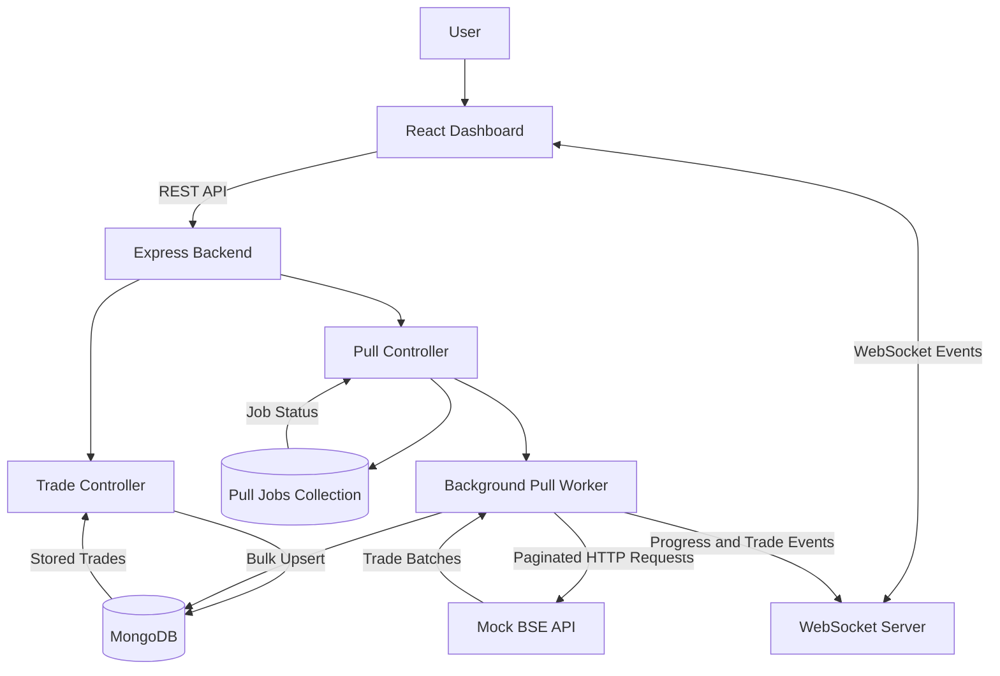

# BSE Trades Dashboard - Architecture

## 1. System Overview

The BSE Trades Dashboard follows a client-server architecture with asynchronous background data ingestion.

The system consists of four main components:

- **React Frontend:** Displays trade records, statistics, connection status, and ingestion progress.
- **Node.js + Express Backend:** Handles API requests, manages pull jobs, and coordinates data ingestion.
- **Mock BSE API:** Simulates an external exchange API by providing paginated trade records.
- **MongoDB:** Persists trade records and pull-job information.

WebSockets provide real-time communication between the backend and connected dashboard clients.

## 2. System Architecture Diagram

## 3. Trade Ingestion Workflow

1. The user clicks the Start Pull button on the dashboard.
2. The frontend sends a request to `POST /api/pull/start`.
3. The backend creates a pull-job record and immediately responds with an accepted status and job ID.
4. The background worker begins processing independently of the HTTP request.
5. The worker retrieves the total record count from the mock BSE API.
6. Trade records are fetched in batches using paginated requests.
7. Each batch is stored in MongoDB using bulk upsert operations.
8. The worker broadcasts newly stored trades and progress updates through WebSockets.
9. The dashboard updates its trade table and progress indicator without requiring a page refresh.
10. Once all records have been processed, the job is marked as completed.

## 4. Real-Time Communication

The application uses WebSockets instead of periodic polling.

The backend broadcasts the following events:

| Event            | Purpose                                                          |
|------------------|------------------------------------------------------------------|
| `PULL_STARTED`   | Indicates that a pull job has started.                           |
| `NEW_TRADES`     | Sends newly processed trade records.                             |
| `PULL_PROGRESS`  | Updates the number of processed records and progress percentage. |
| `PULL_COMPLETED` | Indicates successful completion of the pull.                     |
| `PULL_FAILED`    | Reports a pull-job failure.                                      |

The dashboard establishes its WebSocket connection and loads the existing trade records independently. Incoming trade events are buffered until the initial trade load finishes, helping avoid missing updates during initial loading.

## 5. Database Design

### Trades Collection

Stores individual trade records.

| Field       | Description                      |
|-------------|----------------------------------|
| `tradeId`   | Unique trade identifier          |
| `client`    | Client associated with the trade |
| `symbol`    | Trading symbol                   |
| `quantity`  | Number of traded units           |
| `price`     | Trade price                      |
| `timestamp` | Trade execution timestamp        |

A unique index on `tradeId` supports record uniqueness. Bulk upsert operations insert new records or update existing ones.

### Pull Jobs Collection

Stores information about each ingestion job.

Important fields include:

- Job status
- Total records
- Processed records
- Active-job state
- Start and completion timestamps
- Error details

A unique partial index on the active-job field prevents multiple active pull jobs from being created simultaneously.

## 6. Key Design Decisions

### Asynchronous Background Processing

The pull operation runs in a background worker rather than inside the HTTP request lifecycle. The start endpoint responds immediately, allowing the dashboard to remain usable while ingestion continues.

### Batch-Based Data Retrieval

Trade records are retrieved in batches rather than through one large request. This makes the ingestion process manageable and allows progress to be tracked after each batch.

### MongoDB Persistence

MongoDB stores both trade records and pull-job state. This allows previously retrieved trades to remain available when the dashboard is reopened or the backend restarts.

### WebSockets for Live Updates

WebSockets provide server-initiated updates when new trades arrive or pull progress changes. This avoids the need for repeated polling requests.

### Duplicate Prevention and Job Protection

Unique trade identifiers combined with bulk upserts prevent duplicate trade records. A database-level active-job constraint prevents concurrent pull operations.

### Restart Recovery

On backend startup, jobs left in `pending` or `running` states are identified and marked as failed, and their active-job locks are released. Automatic resumption of interrupted jobs is not implemented.

## 7. Configuration

The backend uses environment variables to configure its runtime behavior.

| Variable               | Purpose                             |
|------------------------|-------------------------------------|
| `PORT`                 | Backend server port                 |
| `MONGO_URI`            | MongoDB connection string           |
| `BSE_PULL_DURATION_MS` | Configured total pull duration      |
| `BSE_BATCH_SIZE`       | Number of records fetched per batch |

The default configuration uses a 15-minute pull duration and a batch size of 100 records.

## 8. Conclusion

This architecture separates dashboard presentation, API handling, background ingestion, real-time communication, and persistent storage.

It enables the dashboard to display existing records immediately while new records are fetched asynchronously and delivered to connected clients in real time. The design also incorporates duplicate prevention, active-job protection, progress tracking, and basic recovery handling for interrupted jobs.